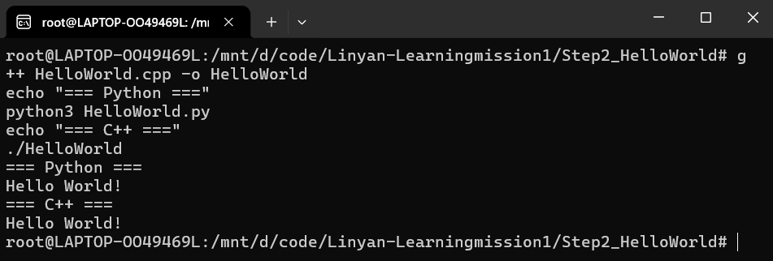

# 工作日志2（2026-11-16）

## 一、工作小记

1. 下载了 Watt Toolkit 给 GitHub 加速并完成登录，熟悉了检索资料、建立个人仓库的基本操作。

2. 通过 GitHub 建立了仓库 https://github.com/Linyan7299/Linyan-Learningmission1 ，在 VS Code 中完成程序的编写，再通过 Ubuntu 和 PowerShell 把程序与这篇工作日志传回 GitHub，初步了解了仓库的运行逻辑。

## 二、工作计划

1. 使用 C++ 编译器完成 HelloWorld 的编译，熟悉文件包含的操作流程，并将其与 .py 文件放在同一目录。

2. 学习 Python 库（OpenCV）的使用，尝试调用摄像头完成相关任务。

3. 下载anaconda + pytorch（GPU）与 ROS2完善编译环境。

## 三、运行示例

